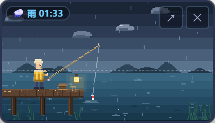
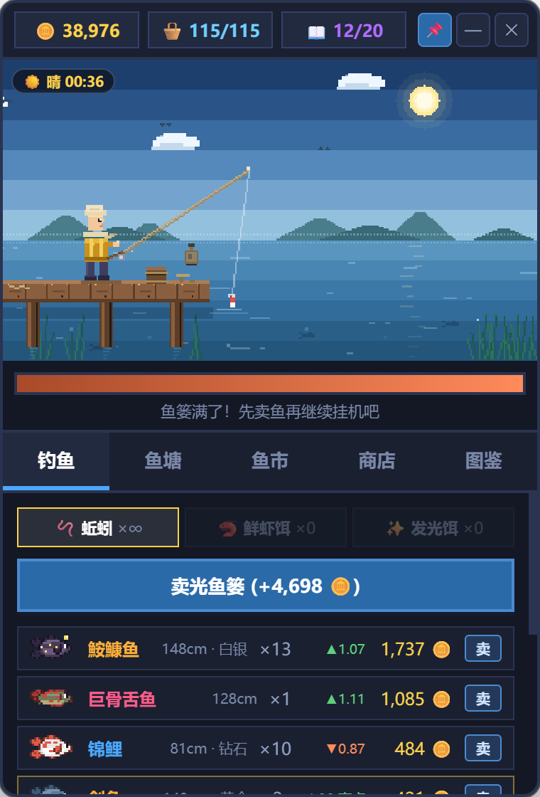
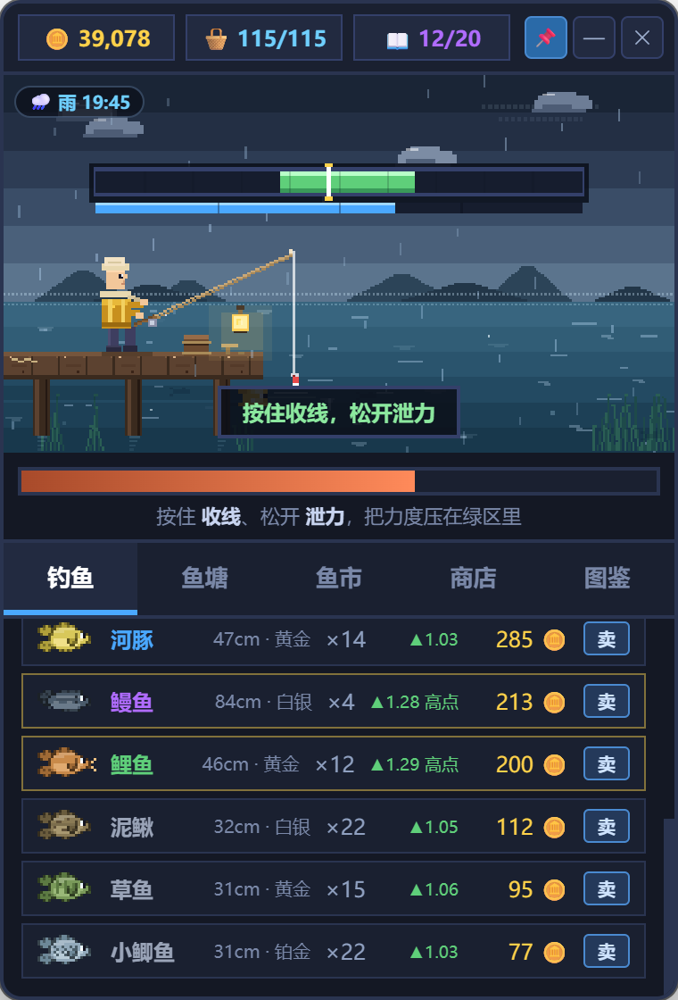
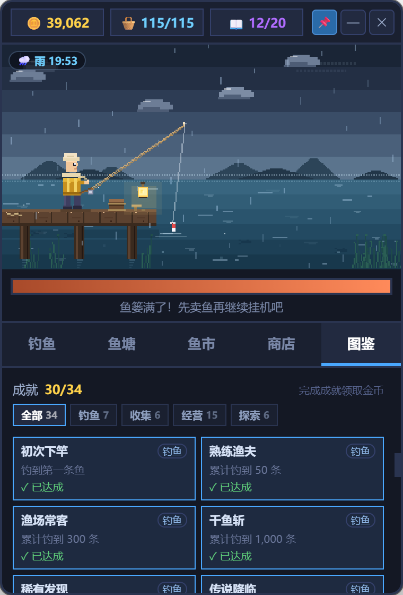
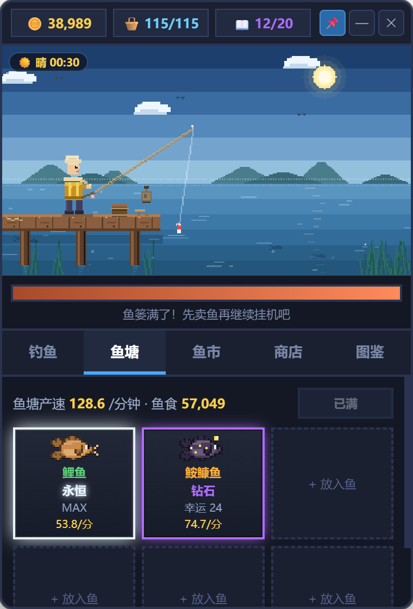
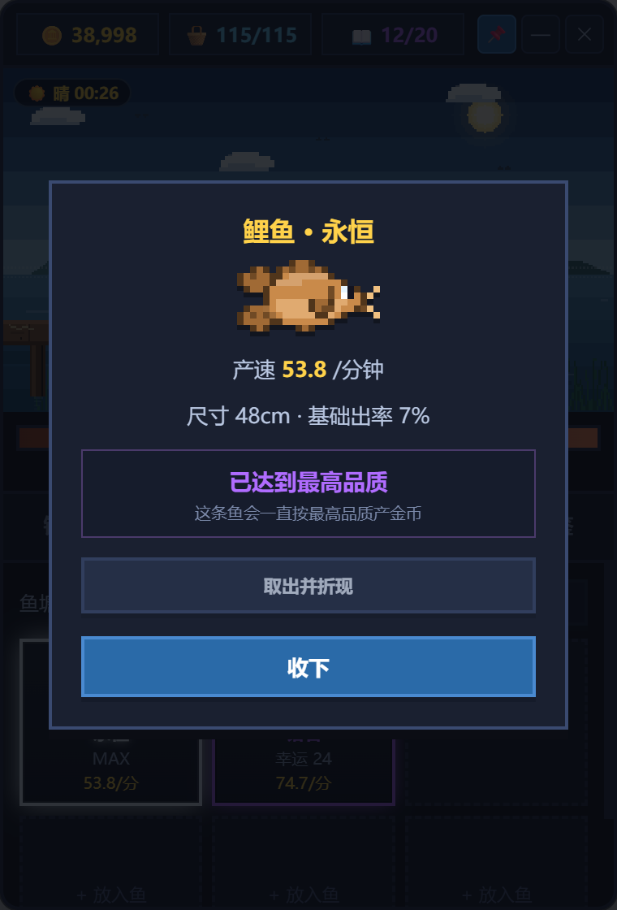
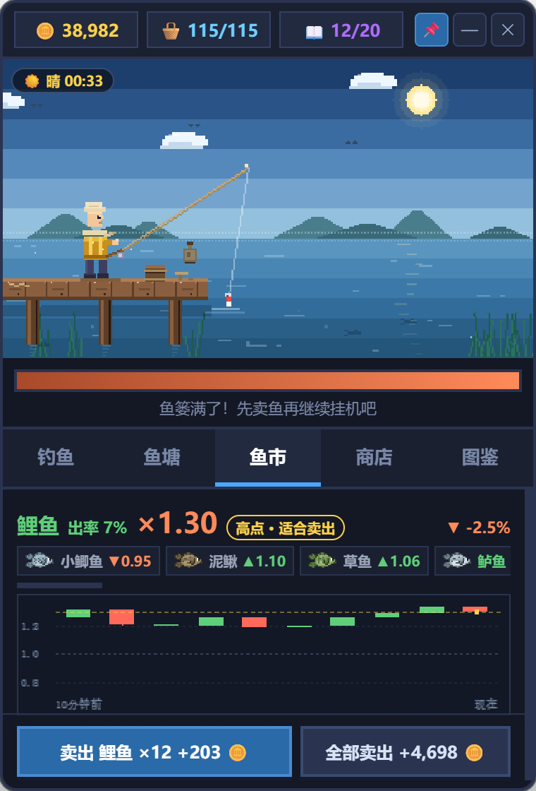

# 像素渔场 · DSH 桌面宠物插件

把「像素渔场」装成一个 DSH 插件：Harness 启动时自动拉起一只透明、无边框、总在最前的像素钓鱼宠物，
像 QQ 宠物一样浮在桌面上，挂机钓鱼、随时展开面板。



## 安装成 DSH 插件（Windows，一条命令）

打开 DSH 的「插件」页 →「添加插件」，填入
`https://github.com/willimqiao/dsh-plugin-pixel-fishing`；也可以用 CLI：

```powershell
dsh plugin --profile desktop add https://github.com/willimqiao/dsh-plugin-pixel-fishing
```

重启 DSH。**首次启动会自动安装宠物本体**：复用 DSH 的 Electron 运行时，装到
`%LOCALAPPDATA%\Programs\dsh-plugin-pixel-fishing`，装好后宠物自己出现；
以后启动只负责把它拉起来，已经在运行就唤到前面。

> 自动安装不额外下载：直接复用本机 DSH 的 Electron 运行时（游戏本体只有 1 MB）。
> 和 DSH 同盘时用硬链接，不占额外空间；跨盘才复制约 270 MB，第一次会等几秒，期间 DSH 照常使用。
> 不想自动安装：在插件配置里设 `autoInstall: false`，再按下面的「安装桌面宠物本体」手动装。

以前装过 `idle-fishing` 启动器的话，先把它移除。单实例锁不会开出第二个窗口，
但两个启动器会抢着启动，没必要同时留着。

## 两种形态

| 形态 | 样子 | 操作 |
|---|---|---|
| 宠物模式 | 220×126 的像素池塘，只有渔夫、浮标和场景 | 按住画面拖动位置；右上角 `↗` 展开；`✕` 退出 |
| 面板模式 | 380×560 完整面板（钓鱼 / 鱼塘 / 鱼市 / 商店 / 图鉴） | 右上角 `—` 收回宠物；标题栏拖动 |

缩小后不显示金币、饵料和卖鱼按钮，只留池塘本身；卖鱼、买饵、升级都在展开的面板里操作。



## 玩法（M1 + 搏鱼张力条）

1. 自动抛竿等待，浮标下沉、头顶冒出 `!` 就是咬钩。
2. **点池塘 / 按空格** 提竿，1.2 秒内都算有效。
3. 提竿后进入搏鱼：**按住收线、松开泄力**，把力度压在绿色安全区里；出率越低的鱼，安全区越窄、发力越凶。
4. 张力拉满会断线，松线超过 0.55 秒会脱钩，7 秒没拉上来鱼就跑了。
5. 搏鱼不再评「完美 / 优质」星级；上岸时只按隐藏的 10 阶品质抽一次价值倍率。
6. 什么都不做也能挂机：0.8 秒自动提竿，92% 成功率。
7. 咬钩等待基础 **10 秒**；鱼竿每升 1 级 −0.25 秒，最快 **6 秒**；鲜虾饵再 ×0.7，每次有 ±10% 自然抖动。



## M2：尺寸 · 图鉴 · 成就

- 每条鱼都有**尺寸（cm）**，同种鱼越大越值钱；最终价格 = 基础价 × 品质倍率 × 尺寸倍率
- **图鉴**记录每种鱼的捕获数、最大尺寸、首次捕获时间
- 集齐 **6 种** 金币 +5%，**12 种** +10%，**20 种** +15%；渔夫还会换上金色衣服
- 集齐全部 **23 种**可解锁「图鉴全满」成就（+1,500🪙），三条超稀有鱼是最后的门槛
- **34 个成就**，分钓鱼 / 收集 / 经营 / 探索四类：累计上鱼、尺寸纪录、天气与鱼饵、鱼塘升级、行情高点卖出、幸运保底、打窝…
- 成就页可以按分类筛选，带进度条、进度数字和金币奖励
- **图鉴鱼图**使用 22×12 的精细像素画：描边、明暗、鳍条，以及每种鱼专属的鳞片 / 斑点 / 条纹 / 胡须 / 背帆 / 鲨鱼鳍 / 星光纹样

### 23 种真实鱼与基础出率

出率是**基础权重**，合计 100%；鱼竿、天气、发光饵和打窝会在此基础上改变权重，界面按四舍五入显示。

| 鱼 | 出率 | 基础价 | 尺寸 |
|---|---:|---:|---|
| 小鲫鱼 | 22% | 2 | 10–30cm |
| 泥鳅 | 18% | 3 | 10–25cm |
| 草鱼 | 15% | 4 | 40–110cm |
| 鲈鱼 | 9% | 6 | 25–70cm |
| 三文鱼 | 6% | 8 | 50–100cm |
| 鲤鱼 | 7% | 10 | 40–120cm |
| 鲶鱼 | 6% | 13 | 50–130cm |
| 河豚 | 4% | 16 | 20–50cm |
| 石斑鱼 | 3% | 20 | 40–120cm |
| 锦鲤 | 2.5% | 26 | 50–100cm |
| 比目鱼 | 2% | 32 | 30–80cm |
| 鳗鱼 | 1.5% | 40 | 40–100cm |
| 旗鱼 | 1% | 50 | 150–300cm |
| 蓝鳍金枪鱼 | 1.2% | 65 | 150–300cm |
| 剑鱼 | 0.8% | 85 | 200–450cm |
| 鮟鱇鱼 | 0.5% | 110 | 30–100cm |
| 金鳟 | 0.3% | 200 | 40–80cm |
| 大白鲨 | 0.15% | 300 | 300–600cm |
| 皇带鱼 | 0.03% | 800 | 300–800cm |
| 巨骨舌鱼 | 0.02% | 1,200 | 200–450cm |
| 腔棘鱼 | 0.01% | 1,500 | 150–200cm |
| 鲸鲨 | 0.006% | 2,200 | 400–1,200cm |
| 皱鳃鲨 | 0.004% | 3,200 | 120–200cm |

> 出率只用于抽鱼和难度；每条第 1–10 阶品质仍会在上岸时单独抽取，决定最终价格。



## M3：鱼塘 · 鱼食 + 金币升级

- 鱼塘 **3 格起**，花金币扩建到 6 格（1,200 / 4,000 / 10,000）
- 把鱼篓里的鱼放进鱼塘，它就开始按分钟产金币，在线 / 离线都算
- 品质：**普通 → 白银 → 黄金 → 铂金 → 钻石 → 星耀 → 王者 → 荣耀 → 传奇 → 永恒（10 阶）**，产速倍率 ×1 / ×1.35 / ×1.8 / ×2.4 / ×3.2 / ×4.2 / ×5.5 / ×7 / ×9 / ×11.5
- 钓到和鱼塘升级**共用同一套品质**：野生也能直接出高阶，只是概率很低（永恒约四万分之一）
- 喂鱼食升级，赌概率进化：

| 阶段 | 消耗鱼食 | 消耗金币 | 基础成功率 | 失败后果 |
|---|---|---|---|---|
| 普通→白银 | 24 | 60 | 55% | 只浪费鱼食和金币 |
| 白银→黄金 | 60 | 150 | 42% | 12% 掉回普通 |
| 黄金→铂金 | 150 | 360 | 32% | 16% 掉回白银 |
| 铂金→钻石 | 360 | 800 | 24% | 18% 掉回黄金，6% 跑鱼（保护符可防） |
| 钻石→星耀 | 800 | 1,800 | 17% | 20% 掉回铂金，8% 跑鱼（保护符可防） |
| 星耀→王者 | 1,700 | 4,000 | 12% | 22% 掉回钻石，10% 跑鱼（保护符可防） |
| 王者→荣耀 | 3,600 | 8,500 | 8.5% | 24% 掉回星耀，12% 跑鱼（保护符可防） |
| 荣耀→传奇 | 7,500 | 18,000 | 6% | 26% 掉回王者，15% 跑鱼（保护符可防） |
| 传奇→永恒 | 15,000 | 40,000 | 4% | 28% 掉回荣耀，20% 跑鱼（保护符可防） |

- **幸运值**：每次失败 +8，每点 +0.5% 成功率；满 100 下一次必成，成功清零
- **保护符** 600🪙：自动挡一次跑鱼；从黄金冲铂金起，没保护符会二次确认跑鱼风险
- 跑鱼会回收一半鱼食和一半金币
- 升级时弹窗会显示：基础概率、幸运加成、掉阶 / 跑鱼风险、本次消耗（鱼食 + 金币）
- 升级有蓄力环、轨道光点、进度条和音调爬升；成功会按品质变色：全屏闪光 + 屏幕震动 + 放射光 + 冲击波 + 星火彩带 + 「升级成功」大印章 + 品质跨越展示 + 产速数字滚动，失败/保护符/跑鱼也有各自的灰烬、红闪或青色护盾
- **鱼食只在商店购买**；卖鱼和离线都不产鱼食；金币既是鱼食的来源，也是升级本身的消耗
- 鱼塘里的鱼只负责产金币；取出会按 50% 价值折现
- 鱼塘格子边框跟随鱼的品质颜色；钻石以上带辉光，永恒最亮





## M3：鱼饵 · 天气 · 鱼市行情

天气按 **20 分钟**轮换；鱼市 K 线则 **1 分钟一根**，两者各自独立。

### 鱼饵

| 鱼饵 | 价格 | 效果 |
|---|---|---|
| 🪱 蚯蚓 | 免费 | 无加成 |
| 🦐 鲜虾饵 | 10 个 60🪙 / 30 个 150🪙 | 上鱼速度快 30% |
| ✨ 发光饵 | 5 个 45🪙 / 15 个 120🪙 | 出率 ≤3% 的鱼权重 ×1.4 |

- 每次抛竿消耗 1 个，挂机自动抛竿也算；用完自动切回蚯蚓

### 打窝（金币换稀有）

- 商店新增 **秘制窝料**：600🪙 / 10 条鱼，最多囤 30 条；快满时按剩余条数补差价
- 接下来成功钓上的 10 条鱼：**出率 ≤2% 的鱼权重 ×3**，**钻石及以上品质权重 ×2**；与发光饵、天气加成乘算
- 成功上鱼才扣 1 条，跑鱼 / 断线不扣；离线结算不消耗也不享受
- 鱼饵条右侧会显示「打窝 ×N」，商店里也能看到剩余条数
- 不叠鱼竿 / 天气时，≤2% 鱼种的总出率从 7.5% 提到约 19.6%；10 条鱼的期望卖价约 112 → 190（不含品质加成），600 窝料赚不回来——它是金币换心跳，不是印钞机

### 天气 / 时段

- 每 20 分钟轮换：**☀️ 晴 / 🌧️ 雨 / 🌙 夜**，场景配色、云、雨丝、星空/月亮都会跟着变
- 晴天锦鲤 ×2.5、草鱼 ×1.3、金鳟 ×2、鲸鲨 ×2；雨天鳗鱼 ×3.5、鲶鱼 ×2.5、皱鳃鲨 ×2；夜晚鮟鱇鱼 ×4、皇带鱼 ×2.2、巨骨舌鱼 ×1.3、腔棘鱼 ×2
- 当前天气和剩余时间显示在场景左上角；离线结算按蚯蚓 + 无天气加成计算

### 鱼市行情（K 线）

- 新增**鱼市**页：23 种鱼各有一条 K 线，**1 分钟一根蜡烛，只显示最近 10 分钟**
- 行情乘数范围 **0.7 – 1.35**；顶部显示当前价、涨跌幅，鱼种芯片显示各自实时乘数
- 价格由存档里的随机种子驱动随机游走，每分钟随机涨跌；同一分钟内刷新价格不变，重启 / 离线后也不会跳变
- 只保存种子，不存 K 线历史；换存档或换种子就是一套全新的行情
- 行情只影响**卖价**，盯着高点出手就行
- 鱼篓行会标出当前行情、涨跌幅和单条「卖」按钮；自动卖鱼买下后可随时关闭，囤鱼等高点
- 自动卖鱼只卖普通渔获：钻石+品质和稀有鱼种会留在鱼篓；篓满后自动暂停挂机
- 鱼市页底部操作条固定在面板下方，不用滚动就能看到：
  - **卖出当前鱼种**：只卖选中的鱼，方便看哪条行情高就卖哪条
  - **卖出全部**：按当前行情一次清篓
- 图表压缩到 82px 高，整页在 380×560 面板里不用滚动



### 商店

- 鱼食三档：20 个 100🪙 / 100 个 450🪙 / 300 个 1,200🪙（买得越多单价越低）
- 鲜虾饵、发光饵按小包/大包出售
- 秘制窝料：600🪙 / 10 条鱼，最多囤 30 条；出率 ≤2% 的鱼权重 ×3、钻石+品质权重 ×2
- 自动卖鱼：首次购买 1,000🪙 后永久解锁，可以在商店里随时开关；开启时钻石+品质和稀有鱼种会留篓
- 鱼竿升级：`60 × 1.7^(等级-1)` 金币；鱼篓升级：`50 × 1.65^(等级-1)` 金币
- 鱼塘升级同时消耗鱼食和金币；金币从“买鱼食的钱”变成“买鱼食 + 升品质”的双重资源
- 保护符：600🪙

## 存档兼容

- 存档键仍是 `pixel_fisher_v1`，当前版本 **v8**。
- v8 起移除六档稀有度和搏鱼星级：界面只显示每条鱼的基础出率；旧鱼篓 / 鱼塘里的优质、完美鱼会按基础价**一次性折算金币**，图鉴和旧成就里的星级字段自动清理。
- 折算只会发生一次（`qualityPaid` 标记），旧档第一次进入新版时会立刻写成 v8 存档，同时保留离线时间戳。
- 品质阶梯仍然保留：普通 → 白银 → … → 永恒，只用于鱼的价值倍率和鱼塘产速。

- 默认以**宠物模式**出现，并**总在最前**，点面板标题栏的 📌 可以取消置顶。
- 托盘图标：左键显示/隐藏，右键菜单可展开、收起、置顶、退出。
- 窗口位置和形态会记住，下次打开还在原处。
- 关掉窗口（`✕` 或托盘退出）才算退出；它不占任务栏。
- 游戏进度存在 `%APPDATA%\dsh-desktop-pet`，和聊天里的版本互不影响。

## 安装桌面宠物本体（手动 / 开发）

插件首次启动时会自动跑这一节；只有关掉了 `autoInstall`、或者想改代码时才需要手动执行。

`install.ps1` 依赖本机已安装的 DeepSeek Harness：复用它的 Electron 运行时，
能硬链接就硬链接，跨盘时退回复制；`resources\app` 默认做成指向本仓库 `app\` 的目录联接，
所以改完代码重开宠物就生效。

脚本就在插件包目录里（从插件市场/包名装的在
`%USERPROFILE%\.dsh\profiles\desktop\node_modules\dsh-plugin-pixel-fishing\`，
从 GitHub 地址或本地目录装的就在对应目录）：

安装位置默认沿用 `D:\deepseek-pet`（如果它已经存在），否则装到
`%LOCALAPPDATA%\Programs\dsh-plugin-pixel-fishing`；可以用 `-InstallDir` 指定。

```powershell
powershell -ExecutionPolicy Bypass -File .\install.ps1
# 找不到 DSH 时手动指定它的安装目录
powershell -ExecutionPolicy Bypass -File .\install.ps1 -DshDir 'D:\deepseek'
# 不用目录联接，复制一份独立的 app（适合给别人安装）
powershell -ExecutionPolicy Bypass -File .\install.ps1 -CopyApp
```

安装脚本会：

1. 安装 Electron 运行时（硬链接或复制 DSH 的 exe、DLL、pak、locales）；
2. 把 `resources\app` 指向本仓库的 `app\`（或用 `-CopyApp` 复制）；
3. 在桌面创建「像素渔场」快捷方式并注册 `dsh-pet://` 协议；
4. 把安装位置写进 `%APPDATA%\dsh-desktop-pet\install.json`，供启动器插件查找。

可选：开机自启

```powershell
powershell -ExecutionPolicy Bypass -File .\install.ps1 -AutoStart
```

会在 `shell:startup` 放一个带 `--pet` 的快捷方式，开机直接以宠物形态出现。

## 手动启动

装好后直接运行安装目录里的 exe；默认位置是
`%LOCALAPPDATA%\Programs\dsh-plugin-pixel-fishing`，已有 `D:\deepseek-pet` 时沿用它。

```powershell
$pet = "$env:LOCALAPPDATA\Programs\dsh-plugin-pixel-fishing\DeepSeek Harness.exe"
& $pet          # 面板形态
& $pet --pet    # 宠物形态
& $pet --full   # 强制展开
```

同一个 exe 重复启动不会开第二个窗口，只会把已有窗口唤到前面。

## 插件行为

`pixel-fishing` 是一个 **host-only 启动器**：

- Harness 启动约 1 秒后自动拉起桌面宠物；已经在运行就只把它唤到前面；
- 找不到宠物时，自动运行包内的 `install.ps1 -CopyApp`，装完再拉起；
- 宠物是独立进程，Harness 退出后它继续留在桌面上；
- 每个 Host 生命周期只尝试一次，HMR 重载不会反复拉窗口或重复安装；
- 在 DSH 里卸载插件时，等包真正从 `node_modules` 移除后，自动清理宠物本体、快捷方式和
  `dsh-pet://` 协议；关闭组合包开关时只关闭宠物、保留安装，正常退出或 HMR 重载不会动它
  （存档始终保留）；
- 查找顺序：`config.petPath` → 环境变量 `DSH_PIXEL_FISHING_PET` → `install.json` 记录 →
  `D:\deepseek-pet` → `%LOCALAPPDATA%` 下的默认位置。

插件配置（在 profile 的 `cordis.patch.yml` 里按 id 覆盖）：

```yaml
- id: pixel-fishing
  config:
    autoStart: true                       # false 则不自启
    autoInstall: true                     # false 则缺失时不自动安装
    petPath: 'D:\deepseek-pet\DeepSeek Harness.exe'
```

宠物没安装且自动安装失败时，插件不影响 Host，只在控制台打一条提醒。

## 卸载

推荐直接在 DSH 的插件页卸载：插件会在包被删掉后自动清理宠物本体、桌面/开机快捷方式和
`dsh-pet://` 协议登记。

也可以手动跑：

```powershell
powershell -ExecutionPolicy Bypass -File .\uninstall.ps1
```

卸载脚本会读取 `install.json` 找到安装位置，删除运行时、桌面/开机快捷方式和
`dsh-pet://` 协议登记；存档目录 `%APPDATA%\dsh-desktop-pet` 保留，加 `-Purge` 一并删除。

自动清理只在 DSH 运行中卸载时生效；本地 `link:` 安装、或者 DSH 关闭后用命令行删包不会
触发，手动跑一次上面的脚本即可。插件只是停用（没有卸载）时宠物会关闭、安装目录保留，
重新启用后会再次拉起。

## 结构

仓库根目录本身就是 DSH 插件包，游戏本体放在 `app/`：

```
dsh-plugin-pixel-fishing/
├─ package.json              # 插件包清单（name = dsh-plugin-pixel-fishing）
├─ cordis.patch.yml          # 向 profile 插入 pixel-fishing 插件行
├─ index.js                  # Host 启动器：查找宠物、拉起、单次保护
├─ icon.svg                  # 插件图标
├─ locale/                   # 插件管理页中英文标题与描述
├─ app/                      # Electron 游戏本体
│  ├─ package.json
│  ├─ main.js                # 窗口、托盘、模式切换、协议、单实例
│  ├─ preload.js             # 最小 IPC 桥
│  └─ renderer/
│     ├─ index.html          # 布局 + 全部 CSS（透明背景 + 标题栏 + 宠物模式）
│     ├─ config.js           # 23 种鱼与逐鱼出率、价格、品质、成就、鱼饵/天气配置
│     ├─ market.js           # 天气轮换 + 确定性 K 线行情
│     ├─ scene.js            # canvas 场景：天空/水面/码头/渔夫/鱼/天气/粒子
│     ├─ game.js             # 状态、存档、钓鱼流程、鱼塘、商店、成就
│     ├─ ui.js               # 面板渲染、鱼市/鱼塘/图鉴 UI、弹窗与特效
│     ├─ pet.js              # 窗口按钮、模式、拖拽（只做窗口壳交互）
│     └─ icon.png            # 托盘图标
├─ install.ps1
├─ uninstall.ps1
├─ tools/                    # 无头测试与调试脚本
└─ README.md
```

## 开发与测试

```powershell
node tools/test-headless.mjs
node tools/test-uninstall-cleanup.mjs
```

无头测试会加载 `config → market → scene → game → ui` 并检查出率、权重、鱼市、商店、
图鉴、存档迁移和自动卖鱼规则，不需要打开窗口。

卸载测试用临时 profile、临时安装目录和临时 `APPDATA` 验证「DSH 卸包后自动清理」，
不会碰本机真实宠物和存档。

## 已知取舍

- 仅支持 Windows：桌面宠物复用 DSH 的 Electron 运行时，安装脚本是 PowerShell。
- 透明窗口在部分显卡驱动/远程桌面下可能没有阴影或边缘发灰，这是 Electron 透明窗口的常见限制。
- 不占任务栏，所以只能通过托盘或桌面快捷方式找回窗口。
- 复用了 DSH 的 Electron 二进制；DSH 升级后如果 Electron 大版本变化，重新跑一次
  `install.ps1` 更新硬链接/副本即可（游戏代码不受影响）。

